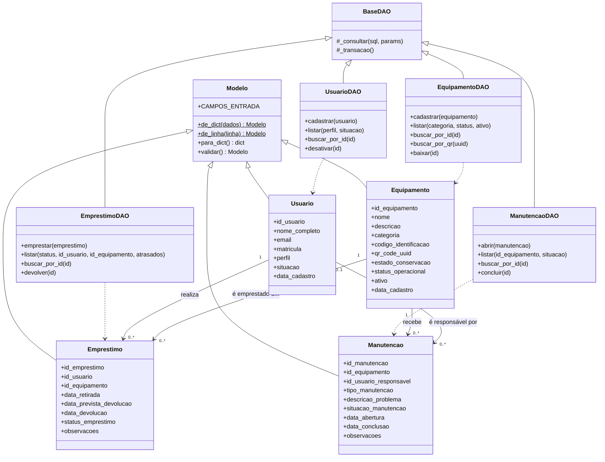
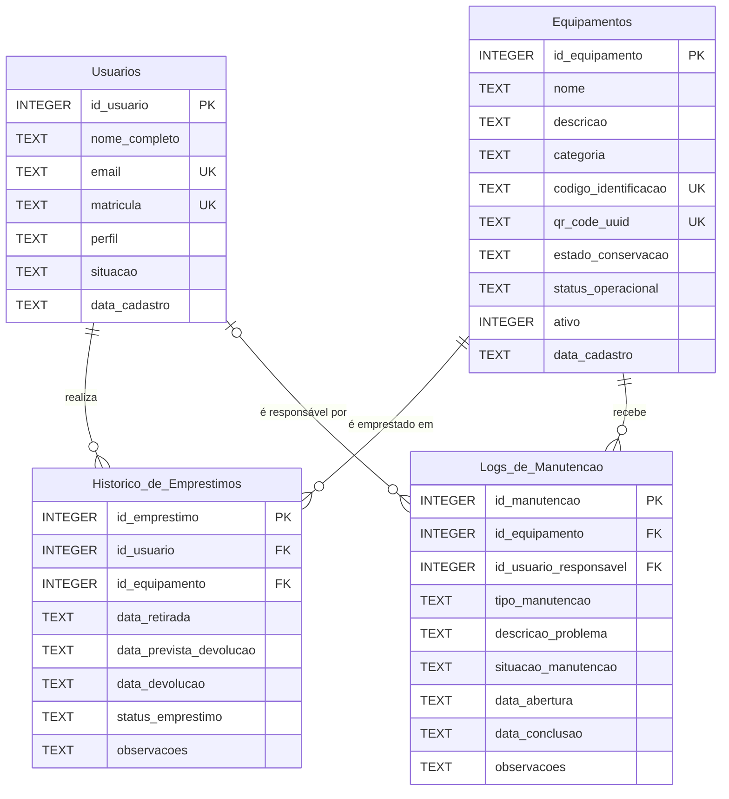

# Modelagem do sistema

Os diagramas abaixo usam Mermaid e aparecem desenhados direto no GitHub.

## Diagrama de classes (UML)

### Exceções

| Classe | Código HTTP | Quando acontece |
|---|---|---|
| `ErroValidacao` | 400 | Dados ausentes ou inválidos |
| `NaoEncontrado` | 404 | O registro não existe |
| `Conflito` | 409 | Uma regra de negócio impede a operação (ex.: equipamento já emprestado) |

## Diagrama entidade-relacionamento

## Valores aceitos nos campos de texto

| Campo | Valores |
|---|---|
| `Usuarios.perfil` | ALUNO, PROFESSOR, ADMINISTRADOR |
| `Usuarios.situacao` | ATIVO, INATIVO |
| `Equipamentos.estado_conservacao` | OTIMO, BOM, REGULAR, RUIM, DANIFICADO |
| `Equipamentos.status_operacional` | DISPONIVEL, EM_USO, EM_MANUTENCAO |
| `Historico_de_Emprestimos.status_emprestimo` | ATIVO, DEVOLVIDO, CANCELADO |
| `Logs_de_Manutencao.tipo_manutencao` | PREVENTIVA, CORRETIVA |
| `Logs_de_Manutencao.situacao_manutencao` | ABERTA, AGUARDANDO_REPARO, CONCLUIDA |

## Regras de negócio

- Só empresta para usuário **ATIVO** e equipamento **ativo** e **DISPONIVEL**; a data prevista de devolução precisa ser futura.
- Ao emprestar, o equipamento passa para **EM_USO**; ao devolver, volta para **DISPONIVEL**.
- Não é possível desativar usuário com empréstimo ativo, nem dar baixa em equipamento emprestado.
- Abrir manutenção coloca o equipamento em **EM_MANUTENCAO** (não é permitido se estiver emprestado); concluir a última manutenção aberta o libera.
- Usuários e equipamentos nunca são apagados (desativação e baixa), para preservar o histórico.
- Cada operação que altera mais de uma tabela roda em uma transação (tudo ou nada).
